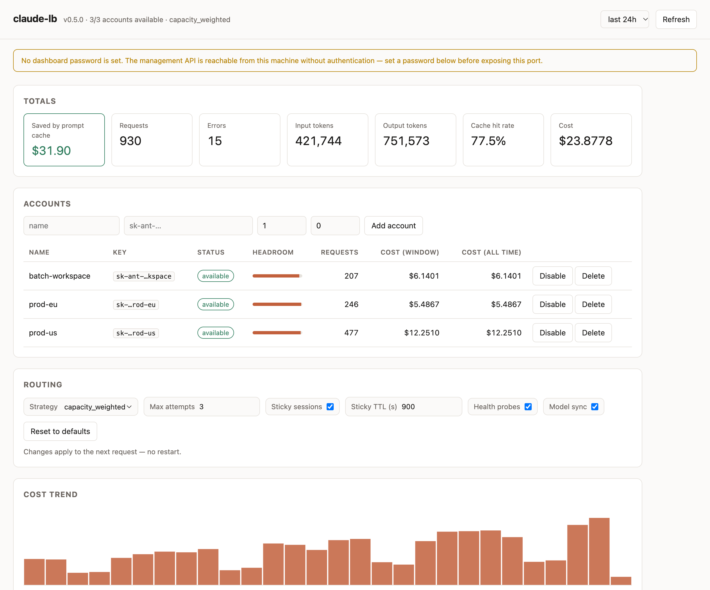
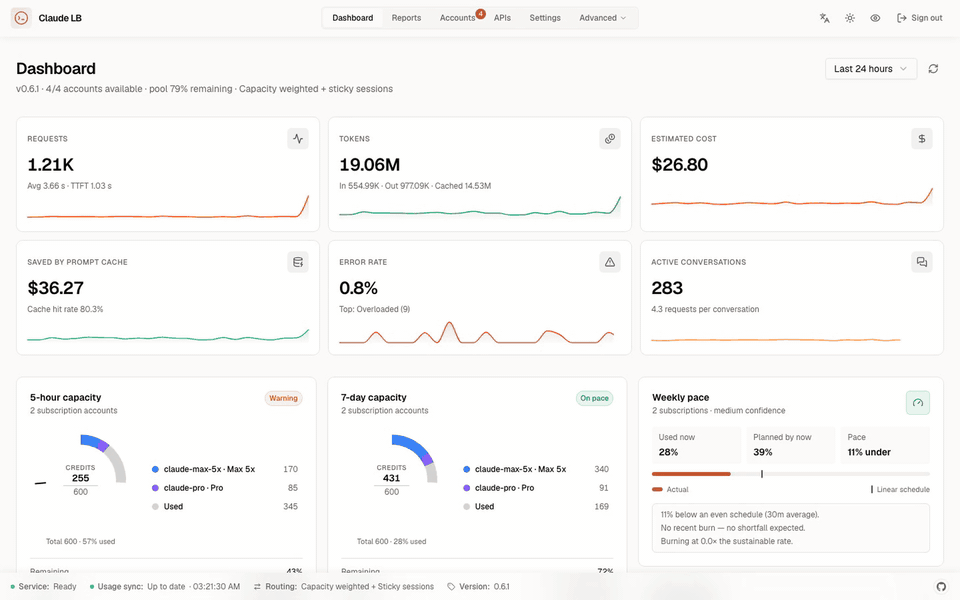
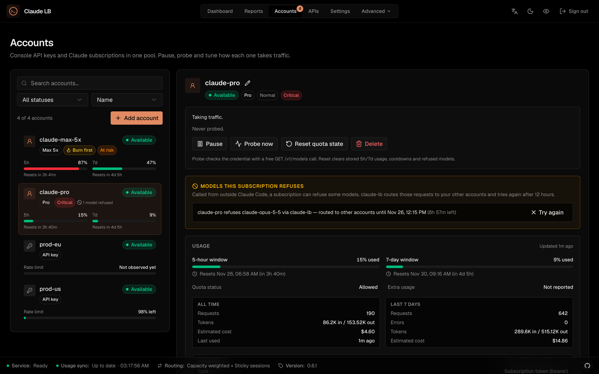
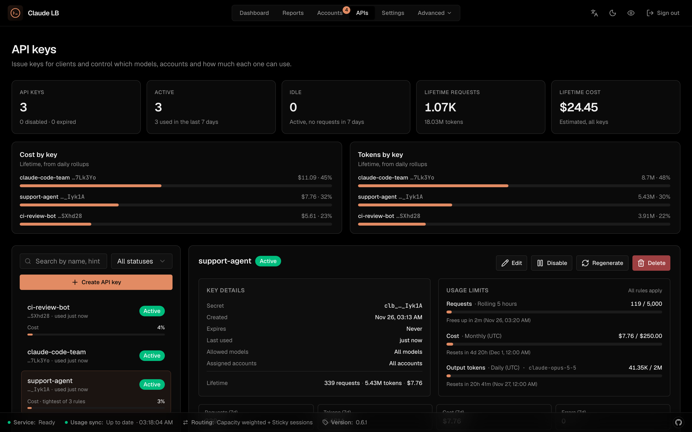
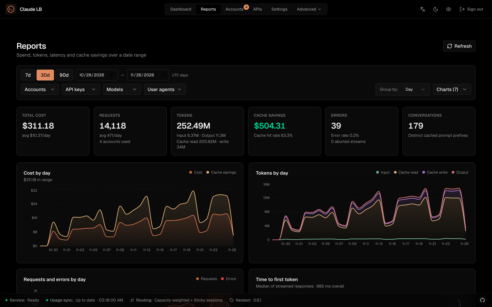
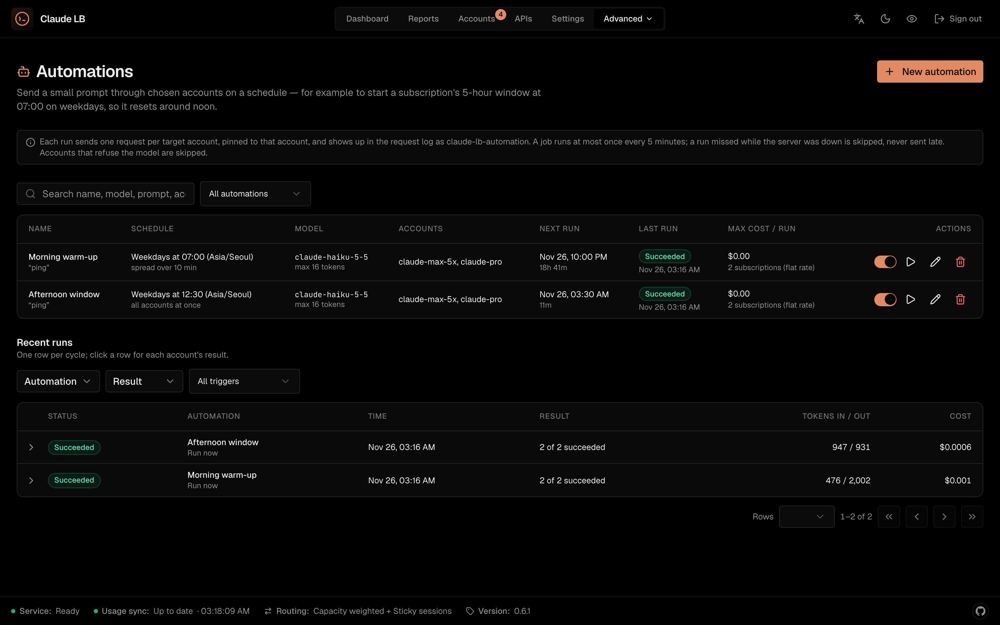
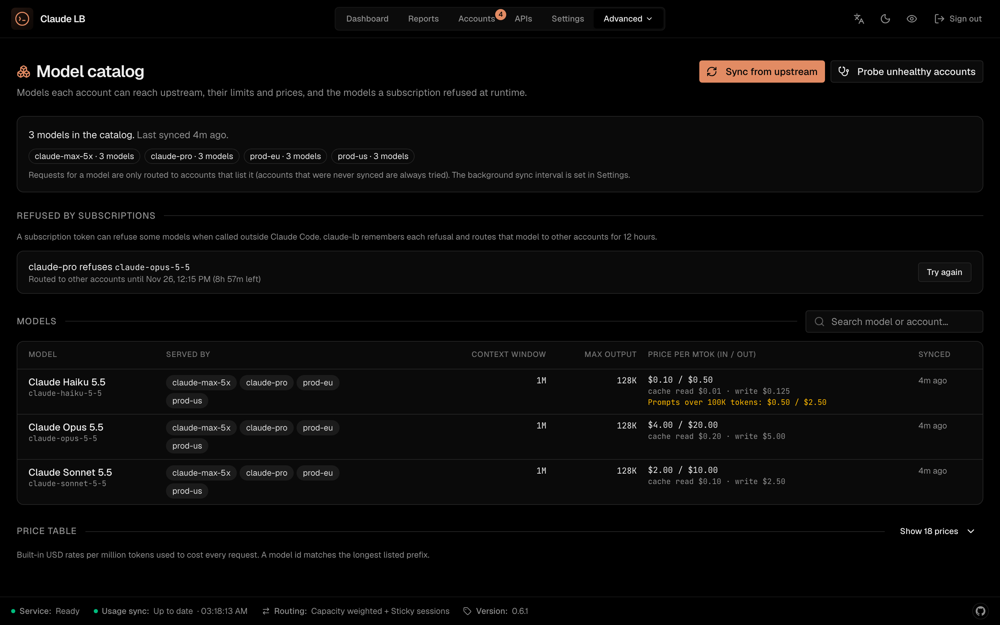
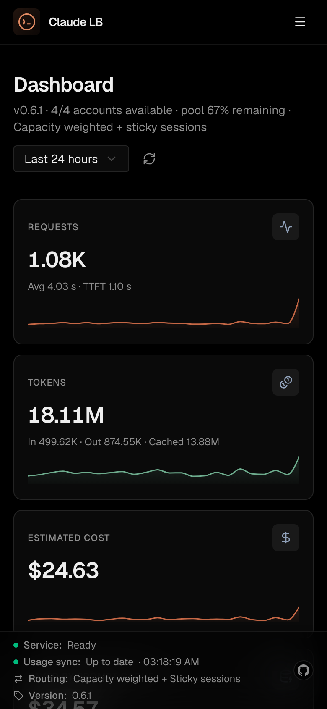

# claude-lb

[](https://github.com/softkleenex/claude-lb/actions/workflows/ci.yml)
[](https://pypi.org/project/claude-lb/)
[](https://pypi.org/project/claude-lb/)
[](LICENSE)

**A self-hosted gateway for Claude subscriptions and Anthropic API keys.** Pool them
behind one endpoint, keep prompt caches warm, and see what every client and model uses.

<picture>
  <source media="(prefers-color-scheme: dark)" srcset="docs/dashboard-dark.png">
  
</picture>

<details>
<summary><b>Watch the 45-second tour</b> (dashboard, capacity, request details, accounts, key rules)</summary>



[MP4 version](docs/media/claude-lb-demo.mp4)
</details>

**Try it without an API key.** Ten seconds, simulated upstream, nothing leaves your machine:

```bash
uvx claude-lb demo
# or
docker run --rm -p 2457:2457 ghcr.io/softkleenex/claude-lb demo
```

## Why

- **Your prompt cache is per key, and a naive load balancer wastes it.** When a turn
  lands on a different key, that key re-writes (at 1.25×) whatever history it hasn't
  cached yet, or the whole prefix if its cache has expired. A read would have cost
  0.025–0.1×. claude-lb pins each conversation to the key that holds its cache. The
  dashboard shows what that saved, priced per model.
- **You can see who spends what.** Every client gets its own `clb_` key with optional
  request, token, or USD budgets. Cost reports by key, account, model, or day export to CSV.
- **One 429 does not take your app down.** Rate limits, overloads (529), and 5xx errors fail
  over to the next key. Keys that recover come back into rotation on their own.

Point Claude Code at it with one command (`claude-lb setup claude-code`). The same goes for
the Anthropic SDKs and anything else that takes a base URL.

### How is this different from LiteLLM or generic LLM proxies?

Most multi-provider gateways treat Anthropic like just another OpenAI-shaped backend. `claude-lb` is built specifically around Anthropic's API and Claude subscriptions:

- **Prompt-cache affinity**: Hashes the cacheable conversation prefix to pin turns to the account holding the warm cache (0.025–0.1× reads instead of 1.25× re-writes) and calculates exact dollars saved per model.
- **5h / 7d unified quota math**: Parses `anthropic-ratelimit-unified-*` headers with EWMA burn-rate depletion forecasting, `burn_first` / `normal` / `preserve` policy tiers, and per-account `spend_cap_usd` failover between subscriptions and Console API keys.
- **Native Claude Code transport (no spoofed OAuth)**: Subscription accounts run through isolated mode-`0700` profiles of Anthropic's unmodified `claude` CLI (tokens passed via env only, built-in tools disabled so client tools round-trip cleanly as `tool_use`).
- **Self-contained single install**: Ships a prebuilt React dashboard inside the Python package and runs on SQLite or PostgreSQL — no Node, Redis, or multi-container stack required (`uvx claude-lb demo` works in 10 seconds).

Inspired by [codex-lb](https://github.com/Soju06/codex-lb), rebuilt for the Anthropic API.

> **Credentials are yours to supply.** claude-lb ships no OAuth client constants for
> any provider — no client ids, no authorize/token endpoints, no impersonated
> first-party identity. An `anthropic_api_key` account takes a Console key; an `oauth`
> account takes an access token plus, optionally, the refresh material *you* provide.

## Features

| | |
|---|---|
| **Subscription + key pooling** | Route requested models across Claude subscriptions and Anthropic API keys in one pool |
| **Bring-your-own credentials** | `x-api-key` or bearer, with RFC 6749 refresh, token rotation, and 401 self-healing |
| **Rate-limit aware** | Reads `anthropic-ratelimit-*` response headers and steers traffic toward headroom |
| **Prompt-cache affinity** | Pins a conversation to one account so its cache stays warm (0.025–0.1x reads, not 1.25x writes) |
| **Automatic failover** | 429/5xx/transport errors retry on the next account; 401/403 disables the key |
| **Self-healing** | Background probes return recovered accounts to rotation without operator action |
| **Model-aware routing** | Skips accounts whose org cannot serve the requested model |
| **Live configuration** | Change strategy, stickiness, and probe intervals from the dashboard — no restart |
| **Dashboard auth** | Password + optional TOTP, with a loopback/bootstrap-token first run |
| **Scoped client keys** | Issue `clb_…` keys with per-window request, token, and USD budgets |
| **Usage + cost tracking** | Per request, account, model, and key — cache reads and 5-minute / 1-hour writes priced per model |
| **Cache savings** | Cache hit rate and the dollars prompt caching saved, per model and account |
| **Trends that outlive logs** | Daily rollups keep a 28-day chart even with short log retention |
| **Prometheus metrics** | `/metrics` exposes per-account health, headroom, tokens, and spend |
| **Audit log** | Append-only record of every management change and sign-in |
| **Cost reports** | Date-range breakdown by day, account, key, or model, with CSV export |
| **Streaming responses** | API-key SSE is relayed unmodified; native Claude Code responses use Anthropic-compatible buffered SSE |
| **Scoped key rules** | Per-key model allowlist, enforced model, assigned accounts, and several limit rules (requests, tokens, USD) over 5h / 7d / daily / weekly / monthly / custom windows |
| **IP firewall** | Optional allowlist of addresses / CIDR ranges for the proxy |
| **Guest role** | Read-only dashboard access with its own optional password |
| **Automations** | Scheduled tiny prompts per account, e.g. to start a 5-hour window before work |
| **Dashboard** | React app (light/dark, English / 한국어 / 简体中文, mobile), shipped prebuilt — no Node needed to run it |

## Quick start

```bash
uv tool install claude-lb          # or: pipx install claude-lb

claude-lb account add work         # prompts for the Anthropic key
claude-lb key create my-laptop     # prints a clb_… key once
claude-lb serve
```

Open <http://127.0.0.1:2456> and set a dashboard password when prompted.

Reaching the dashboard from another machine on the first run? There is no password
yet, so the management plane is loopback-only — paste the one-time bootstrap token
printed in the server log into the setup form. It rotates on every restart and stops
working the moment a password is set.

### Docker

```bash
docker volume create claude-lb-data
docker run -d --name claude-lb \
  -p 2456:2456 \
  -v claude-lb-data:/var/lib/claude-lb \
  ghcr.io/softkleenex/claude-lb:latest
```

## Client setup

claude-lb speaks the Anthropic API, so point any client's base URL at it and use the
`clb_…` key in place of your Anthropic key.

**Python SDK**

```python
from anthropic import Anthropic

client = Anthropic(base_url="http://127.0.0.1:2456", api_key="clb_...")
client.messages.create(
    model="claude-opus-5-5",
    max_tokens=1024,
    messages=[{"role": "user", "content": "Hello"}],
)
```

**TypeScript SDK**

```typescript
const client = new Anthropic({ baseURL: "http://127.0.0.1:2456", apiKey: "clb_..." });
```

**Claude Code / Agent SDK**

```bash
claude-lb setup claude-code     # issues a key, prints the env vars and a settings.json block
```

or by hand:

```bash
export ANTHROPIC_BASE_URL=http://127.0.0.1:2456
export ANTHROPIC_API_KEY=clb_...
```

**curl**

```bash
curl http://127.0.0.1:2456/v1/messages \
  -H "x-api-key: clb_..." \
  -H "anthropic-version: 2023-06-01" \
  -H "content-type: application/json" \
  -d '{"model":"claude-opus-5-5","max_tokens":64,"messages":[{"role":"user","content":"hi"}]}'
```

Every response carries `x-claude-lb-account`, naming the upstream account that served it.

## Dashboard

Open the server's root URL (<http://127.0.0.1:2456> by default). The dashboard is a React
app whose build is committed under `claude_lb/modules/dashboard/static/`, so a plain
install serves it without Node. The UI is available in English and Korean (Simplified
Chinese is partial and falls back to English), in light and dark themes, and down to
phone width.

| Page | What it does |
|---|---|
| **Dashboard** | Requests, tokens, cost, cache savings, error rate and conversations for 1h / 24h / 7d / 30d with sparklines and deltas against the previous window; 5h / 7d subscription capacity donuts with a safe-pace line, weekly pace forecast, API-key spend vs caps; account cards with pause / probe; usage by model; 28-day cost chart; the request log (search, filters, column chooser, per-request details with cost breakdown) and a **Conversations** view grouped by prompt-cache session |
| **Reports** | Cost and usage over any UTC date range (≤ 366 days) with account / API key / model / user-agent filters, comparison with the previous period, cost / token / request / TTFT / TPS charts, model and user-agent distributions, and a breakdown by day, account, key, model or user agent with CSV export |
| **Accounts** | Every upstream account with status, 5h / 7d bars and reset countdowns, spend-cap progress, learned model availability, hourly quota and daily usage charts; pause / resume, probe now, rename, plan / policy / weight / priority / cap, reset quota state, delete (optionally with history); add an API key, paste a subscription token, or import a credential file |
| **APIs** | Client (`clb_…`) keys: create with expiry, allowed models, enforced model, assigned accounts and limit rules; usage per rule with reset times; regenerate, disable, delete; 7-day trends by account and model; a ready-to-paste Claude Code snippet |
| **Settings** | Routing strategy (with a guide to all nine), retries, prompt-cache affinity, background jobs, log retention, dashboard password, TOTP, guest access, IP firewall, reset to defaults |
| **Audit log** *(Advanced)* | Every management change and sign-in, searchable and filterable by action, target, result and time |
| **Model catalog** *(Advanced)* | The synced model catalog with built-in prices (incl. long-context tiers), per-account availability, temporary model reroutes with "try again", sync and probe buttons |
| **Sticky sessions** *(Advanced)* | The in-memory conversation → account map: filter by account, delete entries, purge expired |
| **Automations** *(Advanced)* | Scheduled prompts per account (weekdays, time, IANA timezone, random spread), cost estimate, run now, and a run history per cycle |

**Guest access.** With a dashboard password set, Settings → Guest access lets people sign
in read-only ("Continue as guest", optionally behind a separate guest password). Guests
see everything an admin sees except client IP addresses, and every write returns 403.

**Automations** send a normal request through the chosen account (user agent
`claude-lb-automation/<version>`, `max_tokens` ≤ 1024), so spend and quota are tracked
like any other request. A slot fires at most once (idempotent across restarts and
workers), only within 15 minutes of its time, and "Run now" has a 5-minute cooldown.

| Accounts | API key rules | Reports |
|---|---|---|
|  |  |  |
| **Automations** | **Model catalog** | **Phone** |
|  |  |  |

To work on the dashboard itself, see [frontend/README.md](frontend/README.md).

## Routing strategies

Change live in the dashboard, or set the default with `CLAUDE_LB_ROUTING_STRATEGY`.

| Strategy | Behavior | Use when |
|---|---|---|
| `capacity_weighted` *(default)* | Weighted random over remaining rate-limit headroom × plan capacity × weight | Mixed pools; smooths load without hard-pinning |
| `relative_availability` | Weighted by remaining 7-day quota per time-until-reset (from `codex-lb`) | Subscription pools with staggered weekly reset cycles |
| `usage_weighted` | Picks the account with lowest 7-day (then 5-hour) utilization | Evenly balancing subscription quota burn |
| `reset_drain` | Drains accounts whose quota window resets soonest | Avoiding wasted expiring 5h/7d subscription quota |
| `sequential_drain` | Drains one account before moving to the next | Concentrating load on a primary subscription |
| `round_robin` | Even rotation | Keys with identical limits |
| `least_used` | Fewest lifetime requests | Warming a new key into the pool |
| `fill_first` | Drains the highest-`priority` account before moving on | A cheap/committed-spend key you want consumed first |
| `single_account` | Always the highest-priority enabled account | Debugging, or isolating one key |

Headroom comes from the `anthropic-ratelimit-*` headers on the previous response. An
account never called returns full headroom, so a fresh pool spreads out rather than
piling onto whichever key sorts first.

### Credential types

`claude-lb account add` takes a Console API key and presents it as `x-api-key`.

For an upstream that authenticates with a bearer token, sign in through a browser —
Authorization Code + PKCE, with the endpoints supplied by you:

```bash
claude-lb account login my-account \
  --authorize-url  "https://issuer.example.com/oauth/authorize" \
  --token-endpoint "https://issuer.example.com/oauth/token" \
  --client-id      "$CLIENT_ID" \
  --scope          "user:inference" \
  --base-url       "https://gateway.example.com"
```

claude-lb prints the authorize URL, opens it, and listens on an ephemeral loopback port
for the redirect (RFC 8252). PKCE uses S256, and the `state` parameter is checked
constant-time, so a forged redirect cannot graft its code onto your flow. On a headless
box add `--manual --redirect-uri <the URI registered for your client>`: it prints the
URL and waits for you to paste back the address you were redirected to.

If you already hold the tokens, skip the browser and pass them directly:

```bash
claude-lb account add-oauth my-account \
  --access-token   "$ACCESS_TOKEN" \
  --refresh-token  "$REFRESH_TOKEN" \
  --token-endpoint "https://issuer.example.com/oauth/token" \
  --client-id      "$CLIENT_ID" \
  --expires-in     3600 \
  --base-url       "https://gateway.example.com" \
  --header         "anthropic-beta=some-flag"
```

claude-lb then handles the operational half:

| | |
|---|---|
| **Early refresh** | Runs the `refresh_token` grant before expiry — capped at half the token's own lifetime, so a short-lived token is not re-granted on every request |
| **Rotation** | Persists a rotated `refresh_token` from the grant response; losing it would brick the account |
| **Single-flight** | One grant per account under concurrency, not one per in-flight request |
| **401 self-healing** | A token rejected before its advertised expiry gets exactly one forced refresh and replay, then the account is written off |
| **Breaker** | Three consecutive refresh failures disable the account with the reason recorded |

Tokens, refresh tokens, and client secrets are all encrypted at rest, and API-key and
bearer accounts route side by side in one pool.

### Multi-model subscription pooling

Add your own Claude Pro, Max (`max_5x`, `max_20x`), Team, and Enterprise subscriptions
alongside Console API keys with `codex-lb`-style dual-window quota tracking.
`claude-lb account add-subscription <name>` runs Claude Code's own `claude setup-token`
in a throwaway config directory, so your current Claude Code login is untouched.

Subscription accounts use the `claude_code` transport by default. Each `/v1/messages`
request runs the requested model through an isolated, unmodified Claude Code process
for that account; Console accounts continue to use direct Anthropic HTTP. claude-lb
learns account-specific availability and fails over to another subscription or API key
without imposing a model-family allowlist.

The native transport converts text and client `tool_use` / `tool_result` turns to the
Messages response shape. Non-streaming responses are returned as JSON; streaming
requests receive valid, buffered Anthropic SSE after the Claude Code run completes.
Image/document blocks and exact `max_tokens` enforcement are not available through the
CLI transport, so use a Console API-key account for those request features.

- **5h + 7d quota tracking**: Reads `anthropic-ratelimit-unified-*` headers on every
  response, tracks `rate_limited` (5h) and `quota_exceeded` (7d) states, and
  auto-recovers as soon as the reset timestamp passes.
- **Multi-model subscription routing**: Use `relative_availability`, `usage_weighted`, `reset_drain`,
  or `sequential_drain`, plus per-account `routing_policy` (`burn_first` > `normal` >
  `preserve`).
- **Depletion risk**: Records `QuotaHistory` snapshots to compute EWMA burn rate and
  `safe` / `warning` / `danger` / `critical` pacing badges.
- **Credential import**: Import an existing OAuth/subscription JSON file (including
  `claudeAiOauth` bundles) via `claude-lb account import <name> --file <path>` or
  `POST /api/accounts/import`.
- **Capability learning**: Runtime traffic and model sync keep the per-account routing
  map current automatically for every requested model.

See [docs/subscription-pooling.md](docs/subscription-pooling.md) for the full guide.

### Prompt-cache affinity

Anthropic prompt caches are scoped to the credential that created them. When a turn of
a conversation lands on a different account, that account re-writes (at ~1.25x) the
history it has not cached yet, or the whole prefix once its cache has expired, where a
read would have cost 0.025–0.1x. Modelled on a Claude Code-like session over three keys,
random spreading costs roughly twice what affinity does. claude-lb keys each
request on its *cacheable prefix* (`system` + `tools` + the first user turn), which is
exactly the part Anthropic hashes and exactly the part that stays byte-identical as a
conversation grows, and pins that key to one account.

No client-side session id is needed: turn 20 of a conversation hashes like turn 1.
Cold start and extra workers fall back to rendezvous hashing, so the mapping is stable
without shared state and only ~1/N conversations move when the pool changes.

Affinity is a soft hint. It outranks the routing strategy, but yields to a pinned API
key, to `single_account`, and to any failure. Turn it off with
`sticky_sessions_enabled` if you would rather have perfectly even load.

### Failure handling

| Upstream result | Action |
|---|---|
| `429` | Cool down until `retry-after` (or the reset header), then retry the next account |
| `500` / `502` / `503` / `504` / `529` / `408` | Retry the next account; back off after 3 consecutive failures |
| Transport error | Same as 5xx |
| `401` | Disable the account and record the reason — retrying a revoked key just burns requests (OAuth accounts get one forced refresh first) |
| `403` | Try the next account without disabling anything — a 403 is usually about the request (a model the org lacks), not the key |
| Other `4xx` | Relayed to the caller verbatim, no retry (it's the request's fault, not the key's) |

`max_attempts` (default `3`) caps how many accounts one client request may burn.

A background probe re-checks disabled and past-cooldown accounts against
`GET /v1/models` — authenticated, no token cost — and returns them to rotation on
their own when the credential starts working again. The same call doubles as the
account's model catalog, which routing uses to skip accounts whose org cannot serve
the requested model. An unsynced catalog never blackholes traffic: it falls back to
the whole pool.

## Configuration

Most routing knobs are **runtime settings**: change them in the dashboard (or via
`PATCH /api/settings`) and they apply to the next request, no restart. Environment
variables set the defaults.

| Runtime setting | Default | |
|---|---|---|
| `routing_strategy` | `capacity_weighted` | See the table above |
| `max_attempts` | `3` | Accounts tried per client request |
| `sticky_sessions_enabled` | `true` | Prompt-cache affinity |
| `sticky_ttl_seconds` | `900` | How long a conversation stays pinned |
| `health_probe_enabled` / `_interval_seconds` | `true` / `120` | Auto-recovery probe |
| `model_sync_enabled` / `_interval_seconds` | `true` / `3600` | Model catalog refresh |
| `request_log_retention_days` | `30` | Rollups are kept regardless |

Environment variables use the `CLAUDE_LB_` prefix; `.env` and `.env.local` are read too.

| Variable | Default | Notes |
|---|---|---|
| `CLAUDE_LB_HOST` | `127.0.0.1` | Set `0.0.0.0` to expose it — see the security note below |
| `CLAUDE_LB_PORT` | `2456` | |
| `CLAUDE_LB_DATA_DIR` | `~/.claude-lb` | `/var/lib/claude-lb` in Docker |
| `CLAUDE_LB_DATABASE_URL` | SQLite in the data dir | `postgresql+asyncpg://…` for Postgres |
| `CLAUDE_LB_ROUTING_STRATEGY` | `capacity_weighted` | See above |
| `CLAUDE_LB_MAX_ATTEMPTS` | `3` | Accounts tried per client request |
| `CLAUDE_LB_REQUIRE_API_KEY` | `true` | Set `false` only for a loopback-only dev instance |
| `CLAUDE_LB_DASHBOARD_AUTH_ENABLED` | `true` | Set `false` only behind a proxy that authenticates for it |
| `CLAUDE_LB_UPSTREAM_BASE_URL` | `https://api.anthropic.com` | Per-account override also available |
| `CLAUDE_LB_SECRET_KEY` | generated | Fernet key for credentials at rest; see below |
| `CLAUDE_LB_REQUEST_LOG_RETENTION_DAYS` | `30` | Default for the runtime setting; logs are pruned every 6 h |
| `CLAUDE_LB_DASHBOARD_ENABLED` | `true` | |
| `CLAUDE_LB_LOG_LEVEL` | `INFO` | |

## Security

- **Upstream keys are encrypted at rest** with Fernet. The key lives at
  `$CLAUDE_LB_DATA_DIR/secret.key` (mode `0600`) unless you supply `CLAUDE_LB_SECRET_KEY`.
  Back up the data directory *and* that file together — moving the database without the
  secret makes every stored credential unrecoverable.
- **Client keys are stored hashed** (SHA-256). The plaintext is shown once at creation.
- **The management plane requires an operator session.** Password (scrypt) plus
  optional TOTP; sessions are stored server-side so they can be revoked, and rotating
  the password ends every existing one. A fresh install has no password, so the
  management plane is reachable from loopback only until you set one — or from
  elsewhere with the one-time bootstrap token printed at startup.
  Once a password has been observed, the gate fails **closed**: a read that cannot see
  the credential means "sign in", never "unprotected".
- **Proxy routes are separate.** API clients authenticate with `clb_` keys and are
  unaffected by dashboard sessions. `/health` and `/metrics` stay open so probes and
  scrapers work without a cookie; `/metrics` exposes account *names* and aggregate
  counters, never credentials.
- **The audit log records the fact of a change, never the secret** — names, ids, and
  masked hints only.
- Unknown `/v1/...` paths return 404 rather than being blindly relayed, so a typo in a
  client base URL fails loudly instead of leaking a request upstream.
- **Browser attacks on the management plane are refused.** Before a password exists,
  loopback access also requires a loopback `Host` (defeating DNS rebinding), and any
  state-changing `/api` request a browser sends cross-site is rejected.
- **Sign-in is throttled** (5 failures per client per 5 minutes) and TOTP codes are single-use.
- **Guests are read-only.** A guest session gets 403 on every non-GET management route and
  never sees client IP addresses. Disabling guest access or changing its password ends
  every guest session.
- **The IP firewall guards the proxy only** (`/v1/*`). In allowlist mode a client whose
  TCP peer address is not covered gets a 403 `permission_error`; the dashboard and `/api`
  are never firewalled, so a bad entry cannot lock you out. There is no loopback
  exemption and `X-Forwarded-For` is ignored: behind a reverse proxy every client is the
  proxy's address. An empty allowlist refuses every proxy request.

## Upgrading

Schema changes are applied on startup: columns the models declare but the database
lacks are added in place, idempotently. Existing rows keep their data and take the
column default.

This covers additive changes, which is all claude-lb has needed. Renames, drops, and
type changes are out of scope and will fail loudly rather than guess — back up the data
directory before a major upgrade.

## Data

| Environment | Path |
|---|---|
| Local | `~/.claude-lb/` |
| Docker | `/var/lib/claude-lb/` |

Contains `claude-lb.db` (SQLite) and `secret.key`. Back up both.

## CLI

```
claude-lb serve                    Start the proxy and dashboard
claude-lb demo                     Try it with a simulated upstream — no API key needed
claude-lb setup claude-code        Issue a key and print the Claude Code settings for it
claude-lb config                   Show the resolved configuration
claude-lb account add <name>       Add an upstream Anthropic API key
claude-lb account login <name>     Add an account by signing in through a browser (PKCE)
claude-lb account add-oauth <name> Add a bearer/OAuth account from tokens you already hold
claude-lb account list             Show accounts, health, and spend
claude-lb account remove <name>    Remove an account (history is kept)
claude-lb key create <name>        Issue a client key
claude-lb key list                 List issued keys
```

## Management API

| Method | Path | |
|---|---|---|
| `GET` / `POST` | `/api/accounts` | List / add upstream accounts |
| `PATCH` / `DELETE` | `/api/accounts/{id}` | Update (incl. re-enable) / remove |
| `GET` / `POST` | `/api/keys` | List / issue client keys |
| `PATCH` / `DELETE` | `/api/keys/{id}` | Enable-disable / remove |
| `GET` | `/api/usage/summary?window_hours=24` | Totals, by account, by model |
| `GET` | `/api/usage/requests?limit=100` | Recent request log |
| `GET` | `/api/usage/trend?days=28` | Daily rollups, zero-filled |
| `GET` | `/api/usage/report?group_by=api_key` | Cost over a date range, for chargeback |
| `GET` | `/api/usage/report.csv?group_by=account` | The same report as a CSV download |
| `POST` | `/api/usage/rollups/backfill` | Rebuild rollups from surviving logs |
| `GET` / `PATCH` | `/api/settings` | Read / change runtime configuration |
| `POST` | `/api/settings/reset` | Discard overrides |
| `POST` | `/api/health/probe` | Probe unhealthy accounts now |
| `POST` | `/api/health/sync-models` | Refresh the model catalog now |
| `GET` | `/api/health/models` | Merged model catalog |
| `GET` | `/api/audit` | Management audit log |
| `GET` | `/api/dashboard/overview?timeframe=24h` · `/projections` | Dashboard metrics, deltas, buckets; 5h/7d capacity and weekly pace |
| `GET` | `/api/request-logs` · `/options` · `/{id}` | Paged, filtered request log; filter options; one request with cost breakdown |
| `GET` | `/api/conversations` · `/{session_key}` | Request logs grouped by conversation |
| `GET` | `/api/reports` · `/options` | Date-range report with comparison, medians, distributions |
| `GET` / `POST` | `/api/accounts/{id}/probe` · `/trends` · `/model-blocks` | Per-account probe, trends, retry learned routes |
| `GET` / `POST` | `/api/keys/{id}/trends` · `/regenerate`, `/api/keys/overview` | Key trends, new secret, totals |
| `GET` | `/api/audit/events` · `/actions` | Filtered, paged audit log |
| `GET` | `/api/health/catalog` | Model catalog with prices and temporary reroutes |
| `GET` / `POST` / `DELETE` | `/api/sticky-sessions` … | Browse and delete sticky-session entries |
| `GET` / `PUT` / `POST` / `PATCH` / `DELETE` | `/api/firewall` … | IP allowlist mode and entries |
| `GET` / `PATCH` / `POST` | `/api/auth/guest`, `/api/auth/guest/login` | Guest access config and sign-in |
| `GET` / `POST` / `PATCH` / `DELETE` | `/api/automations` … | Scheduled prompts, run now, run history |
| `POST` | `/api/auth/login` · `/logout` · `/password` | Session management |
| `POST` | `/api/auth/totp/enroll` · `/confirm` | TOTP setup |
| `GET` | `/health` | Liveness (open) |
| `GET` | `/metrics` | Prometheus scrape (open) |

OpenAPI docs at `/docs`.

## Development

```bash
uv sync
uv run pytest
uv run ruff check .
uv run claude-lb serve --reload

# dashboard (Node 20+): dev server on :5173 proxying to the backend on :2456
cd frontend && npm ci && npm run dev
npm test && npm run lint && npm run build   # build output is committed
```

See [CONTRIBUTING.md](CONTRIBUTING.md) and [ARCHITECTURE.md](ARCHITECTURE.md). Security reports:
[SECURITY.md](SECURITY.md).

## License

MIT. The dashboard in `frontend/` is derived from the
[codex-lb](https://github.com/Soju06/codex-lb) frontend, MIT License © 2025 Soju06 — see
[frontend/LICENSE](frontend/LICENSE).
